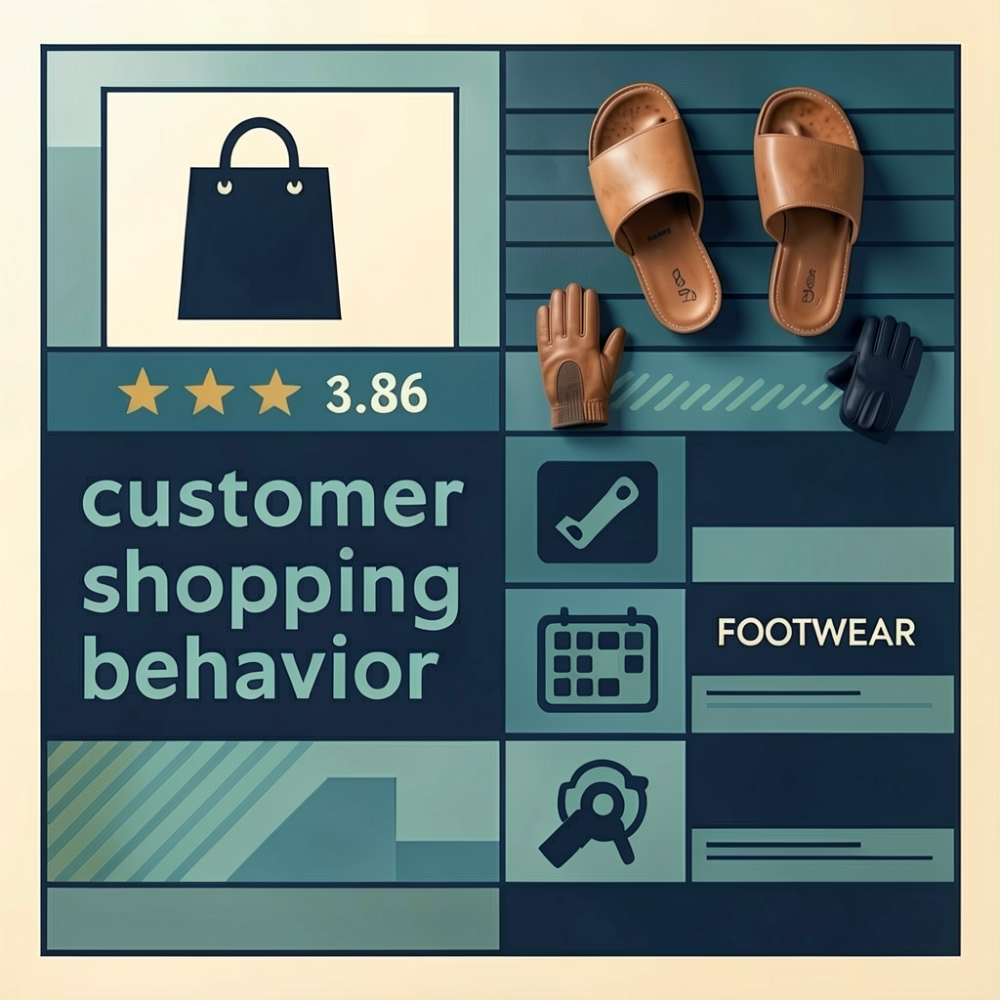
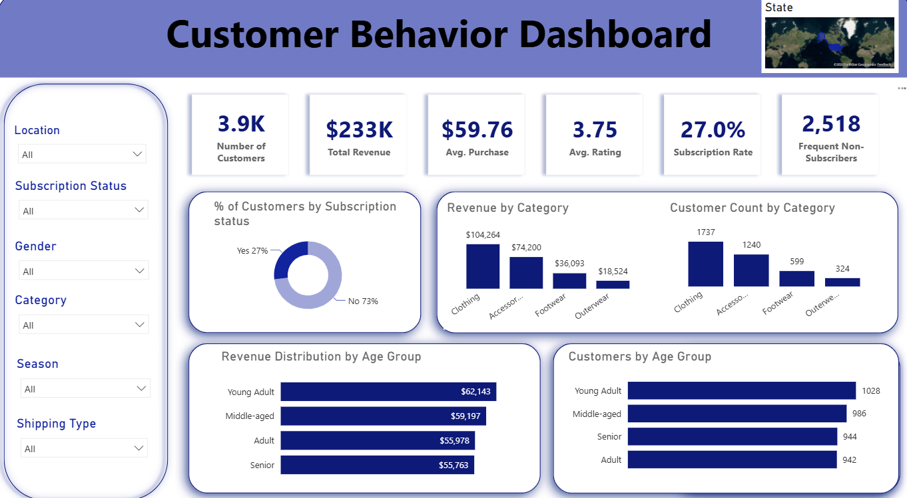

# customer_behavior_analysis
An end-to-end analytics project combining SQL, Python, and Power BI to uncover customer insights, perform segmentation, and deliver a business-focused dashboard.

  

## 📌 Project Overview
This project simulates a real-world data analytics workflow, transforming raw transaction data into actionable business insights.

Using **Python, SQL Server, and Power BI**, I analyzed ~3,900 customer purchase records to understand:
- Customer behavior and spending patterns  
- Product performance across categories  
- Opportunities to improve retention and revenue  

---

## ⚙️ Tools & Technologies
- **Python (Pandas)** - data cleaning & feature engineering  
- **SQL Server (T-SQL)** - data storage & business analysis  
- **JupyterLab** - interactive analysis  
- **Power BI** - dashboard & data visualization  

---

## 🔄 Project Workflow

1. **Data Preparation (Python)**
   - Cleaned missing values and standardized dataset
   - Created new features such as `age_group` and purchase frequency

2. **Data Analysis (SQL)**
   - Loaded data into SQL Server
   - Answered key business questions using:
     - CASE statements
     - CTEs
     - Window functions

3. **Visualization (Power BI)**
   - Built an interactive dashboard with 6 KPI cards: Customers, Total Revenue, Avg. Purchase, Avg. Rating, Subscription Rate and Frequent Non-Subscribers
   - Wrote DAX measures (`CALCULATE`, `DIVIDE`, `DISTINCTCOUNT`) for subscription rate and target customers
   - Enabled filtering by location, subscription status, gender, category, season and shipping type

---

## 📊 Key Insights

- 💰 **Revenue Distribution**  
  Male customers generate **68% of total revenue**, while female customers have slightly higher average spend per transaction  

- 🎯 **High-Value Customers**  
  Customers using discounts still spend above average → not purely price-sensitive  

- ⭐ **Top Rated Products**  
  Gloves, sandals and boots have the highest average ratings (3.82–3.86), all from the accessories and footwear categories  

- 🔁 **Customer Loyalty**  
  ~80% of customers are loyal (more than 10 previous purchases) and only 83 are new → strong retention but limited new acquisition  

- 🚀 **Business Opportunity**  
  Only **27% of customers are subscribed**, and **2,518 frequent buyers (more than 5 previous purchases) are not**, the clearest target group for a subscription campaign

---

## 📈 Dashboard Preview

    

